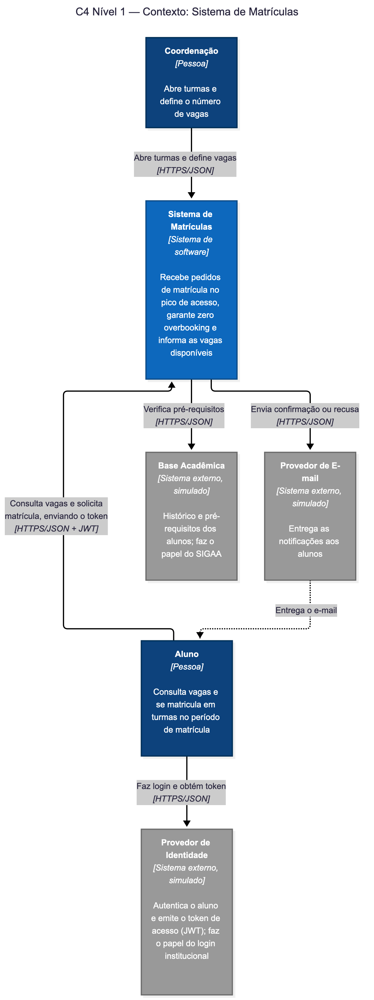
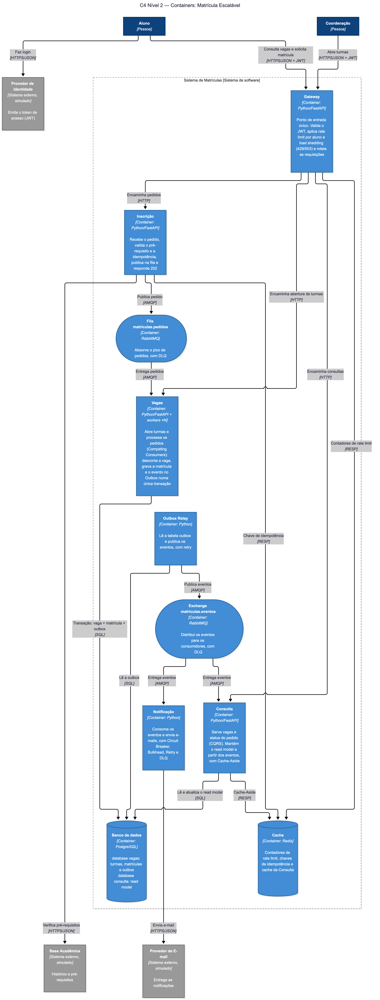

# Matrícula Escalável

Sistema distribuído de inscrição em disciplinas resiliente a picos de acesso.
Projeto Final de Engenharia de Sistemas Distribuídos — UFPB, 2026.2.

## Equipe

| Integrante | Contato |
| --- | --- |
| Daniel Victor Carneiro Brandão da Costa | danielvictorcarneiro21@gmail.com |
| Davi Nasiasene Amorim | davi.ted@hotmail.com |
| Ian Rocha Bittencourt | ianbittencourt03@gmail.com |

## Problema

No início do período, milhares de alunos disputam poucas vagas no mesmo instante. Sistemas monolíticos degradam, caem ou aceitam matrículas além da capacidade (overbooking). Este projeto propõe uma arquitetura distribuída que absorve o pico por meio de fila, protege o núcleo com rate limit e load shedding e garante que nenhuma vaga seja excedida nem duplicada, mesmo com retentativas e falhas parciais.

## Áreas técnicas

- **Aprofundadas:** Escalabilidade e Desempenho
- **Complementar:** Confiabilidade (e Deployment, como bônus)

## Padrões arquiteturais

| # | Padrão | Área |
| --- | --- | --- |
| 1 | Queue / Competing Consumers | Escalabilidade |
| 2 | Rate Limit + Load Shedding | Desempenho |
| 3 | CQRS + Cache-Aside | Desempenho |
| 4 | Idempotência | Confiabilidade |
| 5 | Transactional Outbox + Retry/DLQ | Confiabilidade |
| 6 | Circuit Breaker + Bulkhead | Confiabilidade |

Padrões considerados e descartados (com justificativa nos ADRs): SAGA/Orchestration, Inbox, Request Hedging, Service Mesh, Event Sourcing.

## Arquitetura

### C4 Nível 1 — Contexto



### C4 Nível 2 — Containers



### Serviços

| Serviço | Responsabilidade |
| --- | --- |
| Gateway | Entrada única, rate limit |
| Inscrição | Processa a fila de matrículas (workers) |
| Vagas | Controle atômico de vagas |
| Consulta | Leitura de vagas e disciplinas (CQRS, cache) |
| Notificação | Envia confirmações a partir de eventos |

### Decisões arquiteturais (ADRs)

Os ADRs ficam em [`docs/adr/`](docs/adr/).

| ADR | Decisão | Status |
| --- | --- | --- |
| [001](docs/adr/0001-vagas-dono-da-escrita-de-matricula.md) | Vagas como único dono da escrita de matrícula | Proposto |
| [002](docs/adr/0002-read-model-proprio-da-consulta.md) | Read model próprio da Consulta (CQRS + Cache-Aside) | Proposto |

## Stack

Python com FastAPI · RabbitMQ · PostgreSQL · Redis · Docker Compose · GitHub Actions · k6 · Prometheus · Grafana · OpenTelemetry + Jaeger

## Como executar

```bash
# pré-requisitos: Docker e Docker Compose
git clone https://github.com/ianbitt/sigaa2_ERS2026.2.git
cd sigaa2_ERS2026.2
docker compose up --build
```

Por enquanto cada serviço só expõe `/health` e `/metrics` (esqueleto); a lógica de negócio entra ao longo do Projeto 03.

| Serviço / painel | URL |
| --- | --- |
| Gateway | `http://localhost:8000` |
| Inscrição | `http://localhost:8001` |
| Vagas | `http://localhost:8002` |
| Outbox Relay | `http://localhost:8003` |
| Consulta | `http://localhost:8004` |
| Notificação | `http://localhost:8005` |
| Grafana | `http://localhost:3001` |
| Prometheus | `http://localhost:9090` |
| RabbitMQ (management) | `http://localhost:15672` |

## Testes

| Tipo | O que valida | Como rodar |
| --- | --- | --- |
| Carga progressiva | Fila, rate limit, load shedding (p95, taxa de sucesso) | `[comando k6]` |
| Concorrência | Muitas requisições para a mesma vaga, sem overbooking | `[comando]` |
| Resiliência | Queda de instância de inscrição, do broker e da notificação | `[comando]` |
| Integração | Fluxo completo, Outbox, retry e DLQ | `[comando]` |

### Critérios de sucesso

1. Com [5.000] usuários em 1 minuto disputando [200] vagas: zero matrículas além da capacidade e zero duplicadas.
2. p95 da consulta de vagas abaixo de [200 ms] sob essa carga.
3. Sob sobrecarga, taxa de sucesso das matrículas aceitas ≥ [95%], com comparativo com e sem load shedding.
4. Queda de uma instância de inscrição no pico: nenhuma matrícula perdida ou duplicada e recuperação em menos de [30 s].
5. Serviço de notificação fora do ar: inscrição continua com taxa de sucesso ≥ [95%] e notificações pendentes entregues após a recuperação.

### Resultados

> TODO (Projeto 03): gráficos e métricas coletadas.

## Cronograma

| Entrega | Data | Status |
| --- | --- | --- |
| Projeto 01: grupo e tema | 09/10/2026 | Concluído |
| Projeto 02: documentação inicial | 06/11/2026 | Concluído |
| Projeto 03: documentação final e apresentação | 11/12/2026 | Pendente |

## Ferramentas de IA utilizadas

> Seção obrigatória. A omissão desclassifica a entrega. Atualizar ao longo do projeto.

| Ferramenta | Onde atuou | Como foi orientada | O que funcionou | O que precisou ser corrigido ou foi descartado |
| --- | --- | --- | --- | --- |
| Claude | Avaliação dos padrões e rascunho da proposta de tema | [contexto fornecido: documento do projeto e material de padrões] | Ajudou na criação do documento e definição de testes | - |

## Licença e atribuições